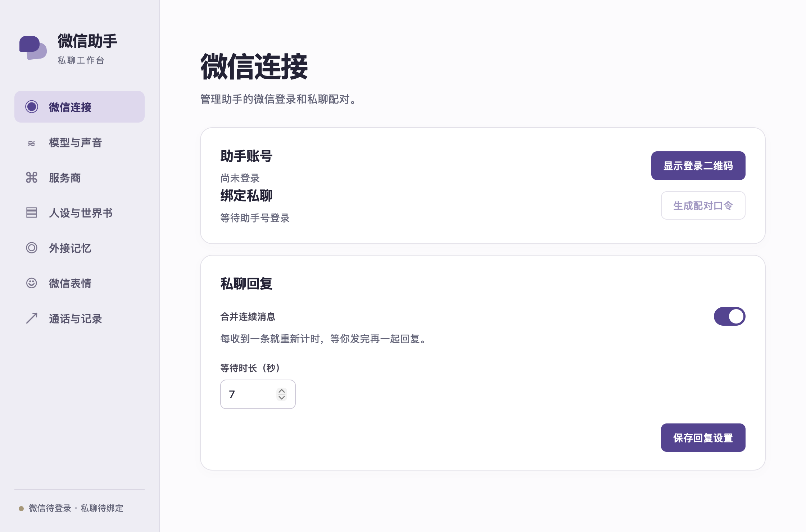

# WeChat Voice Bridge

在自己的 Linux VPS 上，把一个普通微信号接到聊天模型。助手号扫码登录后，和一个好友私聊，可以收发文字、语音条、表情包，也可以接打微信语音电话。微信连接使用 [Agent WeChat 3.1.0](https://github.com/thisnick/agent-wechat/tree/v3.1.0)。

## 私聊怎么工作

工作台把好友发来的内容连同最近的对话交给聊天模型，再通过微信发回回复。语音条先转成文字，回复需要朗读时交给语音合成服务。图片可以选识图模型，表情包从助手号已添加的整包和收藏中选。

在「微信连接 → 私聊回复」可以开关「合并连续消息」。默认开启，等待 7 秒。每来一条就重新计时，你可以把秒数改成自己习惯的值。关闭后，每条消息各回一轮。助手已经回复后，你再发的消息会开启新一轮。

## 微信电话怎么工作

在私聊里说「打给我」，助手会拨给已绑定的好友。如果想从手机拨给助手，先在「通话与记录」点「等待来电」，两分钟内拨入。

接通后，讯飞可以边听边转写。你停下来后，聊天模型结合转写和最近对话生成答句。ElevenLabs 一生成第一段声音，VPS 就送回微信，随后边合成边播放。你中途插话，助手会停下来听。助手决定结束通话时，会先说完道别再挂断。私聊的合并秒数只管聊天消息，通话单独判断停顿。

这套配置在手机上的实际体验是说完后约 **4 秒**听到回应。一次记录中，从最后一帧人声到 VPS 发出第一帧回复音频用了 **3.28 秒**。工作台「通话与记录」里的“上一轮开口用时”显示这个服务器侧时间，手机端还要接收和播放。换网络、模型或音色后，实际用时会变化。[通话实现](call_channel.py)

## 第一次部署

准备一台使用 systemd 的 **Ubuntu 24.04 x86-64 VPS**、一个能扫码的助手号和一个日常聊天号。先配聊天模型就能试文字。中文听写建议先用讯飞流式听写，官方给新用户默认每天 500 次免费测试调用。回复的声音可用 ElevenLabs，填自己的合成模型和 Voice ID。各服务分别按自己的账号和套餐使用。[讯飞听写免费额度](https://www.xfyun.cn/service/voicedictation)

**在 VPS 上安装**

~~~sh
sudo apt-get update
sudo apt-get install -y git ca-certificates curl ffmpeg iproute2 util-linux python3-venv
git clone https://github.com/miaow-fish/wechat-voice-bridge.git
cd wechat-voice-bridge
sudo bash install-agent.sh
sudo bash install-panel.sh
~~~

拿到源码压缩包的朋友，先执行上面两行 `apt-get` 安装系统依赖，再解压并进入含 `install-agent.sh` 的目录，执行最后两行。安装脚本会校验固定版本的微信程序，并将语音依赖安装到项目自己的目录。

**在自己电脑上打开工作台**

把下方的 `user@your-vps` 换成平时 SSH 登录 VPS 用的地址。

~~~sh
ssh -N -o ExitOnForwardFailure=yes -L 127.0.0.1:28227:127.0.0.1:28222 user@your-vps
~~~

这个终端保持打开，在浏览器访问 [本机工作台](http://127.0.0.1:28227/)。日常聊天时可以关掉这个终端，两个服务由 VPS 上的 systemd 常驻。

1. 在「微信连接」显示二维码，用**助手号**扫码，在手机上确认电脑端登录。同一账号原有的电脑端可能被挤下线。
2. 生成配对口令，从**日常号**把口令私发给助手号。页面显示「已绑定私聊」后，只有该私聊会触发回复。
3. 在「服务商」填自己的凭据，在「模型与声音」选聊天模型并保存。先发一句「你好」验通文字，再按需要启用听写和语音合成。

模型搭配、音色设置、来电接听和常见安装问题见[配置与排查手册](docs/setup.md)。

## 数据与许可证

微信登录、API 凭据、聊天记录和表情缓存在部署者的 VPS 上。聊天内容会发给你选的模型服务。启用云端识图、听写或语音合成时，对应服务会收到待识别的图片、待转写的音频或待朗读的文字。管理页和账号接口默认仅监听 VPS 的回环地址。

本项目使用 [MIT 许可证](LICENSE)。微信账号连接与通话媒体由上游提供。其原生程序从上游发行页下载，附带组件依各自的许可使用。[Agent WeChat 发行页](https://github.com/thisnick/agent-wechat/releases/tag/v3.1.0) · [上游许可证](https://github.com/thisnick/agent-wechat/blob/v3.1.0/LICENSE)
